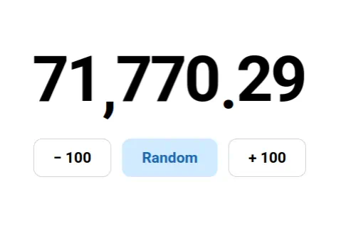

# @guoyunhe/react-odometer

A React component for smooth, rolling number animations.



The recording above shows the digits rolling as the value changes. Open the [**📺 Live Demo**](https://guoyunhe.github.io/react-odometer/) to try it yourself.

## Installation

```sh
npm install --save @guoyunhe/react-odometer
```

## Usage

```tsx
import { Odometer } from '@guoyunhe/react-odometer';
import { useState } from 'react';

export function Counter() {
  const [value, setValue] = useState(12345);

  return (
    <button onClick={() => setValue((current) => current + 1)}>
      <Odometer value={value} separator=',' />
    </button>
  );
}
```

`OdometerProps` is also exported for TypeScript users.

The component accepts and forwards standard `<span>` attributes, including `aria-*` and `data-*` attributes, event handlers, and `ref`. Its rendered children remain managed by the component.

## API

| Prop        | Type            | Default | Description                                       |
| ----------- | --------------- | ------- | ------------------------------------------------- |
| `value`     | `number`        | —       | Number to display.                                |
| `duration`  | `number`        | `1000`  | Digit animation duration in milliseconds.         |
| `decimals`  | `number`        | `0`     | Number of fraction digits to display.             |
| `separator` | `string`        | `''`    | Thousands separator; an empty string disables it. |
| `decimal`   | `string`        | `'.'`   | Decimal separator.                                |
| `className` | `string`        | —       | Class name applied to the root element.           |
| `style`     | `CSSProperties` | —       | Inline styles applied to the root element.        |

Negative values are displayed with a leading minus sign. The component uses the surrounding font size and inherits text styling.

For an aligned place-value change such as `19` to `29`, the units wheel turns once while the tens wheel advances one digit, giving the lower wheel 10 times the angular speed. At carries, each wheel follows its actual digit change. A single update animates at most ten complete turns per wheel before settling on its final digit.

## License

Licensed under the [GNU Affero General Public License v3.0 only](./LICENSE).
